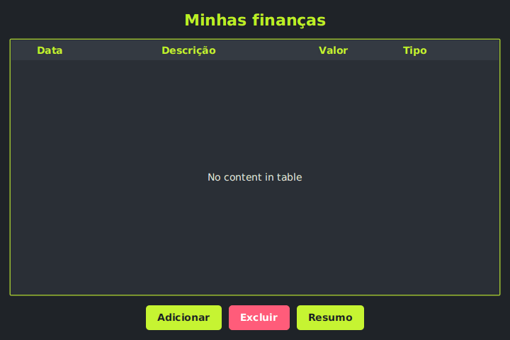

# FinTrack

Sistema de controle de finanças pessoais em Java, desenvolvido no curso **Capacita iRede**.

A primeira versão funcionava no console. Nesta versão o projeto ganhou interface gráfica com JavaFX, banco de dados com JDBC, Generics e testes automatizados com JUnit.

   

## Funcionalidades

- Cadastrar receitas e despesas
- Listar as transações em uma tabela
- Ver o saldo atual, o total de receitas e o total de despesas
- Remover uma transação, com confirmação

## Tecnologias

- Java 17 ou superior
- JavaFX 21 (FXML e CSS)
- JDBC com SQLite
- JUnit 5
- Maven

## Estrutura do projeto

```
fintrack/
├── pom.xml
├── src/main/java/
│   ├── app/FinApp.java
│   ├── controller/
│   │   ├── FinTracker.java
│   │   ├── PrincipalController.java
│   │   ├── NovaTransacaoController.java
│   │   └── RelatorioController.java
│   ├── dao/
│   │   ├── Conexao.java
│   │   └── TransacaoDAO.java
│   ├── exceptions/EntradaInvalidaException.java
│   ├── model/Transacao.java
│   ├── repositorio/RepositorioGenerico.java
│   └── utils/Formatador.java
├── src/main/resources/
│   ├── view/
│   │   ├── principal.fxml
│   │   ├── nova-transacao.fxml
│   │   └── relatorio.fxml
│   └── css/estilo.css
└── src/test/java/
    ├── model/TransacaoTest.java
    ├── repositorio/RepositorioGenericoTest.java
    ├── dao/TransacaoDAOTest.java
    └── controller/FinTrackerTest.java
```

## Conceitos aplicados

- **Generics:** `RepositorioGenerico<T>` com os curingas `?`, `? extends T` e `? super T`
- **JavaFX:** `FinApp` estende `Application`, telas em FXML com controllers, `TableView`, `DatePicker`, `CheckBox` e eventos com `setOnAction()`
- **JDBC:** tabela `transacoes`, CRUD com `PreparedStatement` e `ResultSet`, `commit()` e `rollback()`
- **JUnit:** `@Test`, `@BeforeEach`, `@AfterEach`, `assertEquals` e `assertThrows`, com SQLite em memória nos testes do DAO

## Banco de dados

O banco é um arquivo SQLite (`fintrack.db`) criado automaticamente na primeira execução. Não é preciso instalar nem configurar nada.

```sql
CREATE TABLE transacoes (
  id INTEGER PRIMARY KEY AUTOINCREMENT,
  descricao VARCHAR(100),
  valor DECIMAL(10,2),
  tipo VARCHAR(10),
  data DATE
);
```

## Como rodar

Precisa do JDK 17+ e do Maven instalados.

```
git clone https://github.com/kenniataisa/FinTrack.git
cd FinTrack
mvn javafx:run
```

No NetBeans: abrir o projeto, selecionar `fintrack` e executar o objetivo `javafx:run` (Navigator > javafx run).

## Como testar

```
mvn test
```

## Autoria

Trabalho feito para o curso Capacita iRede.
